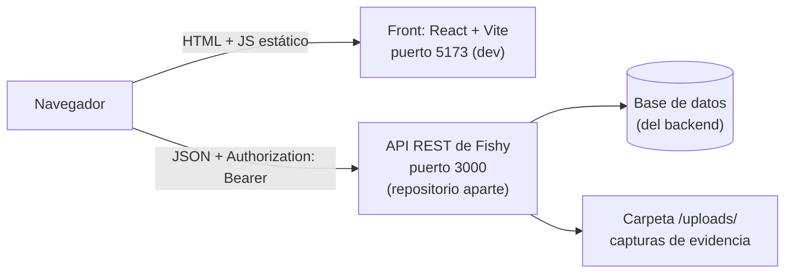
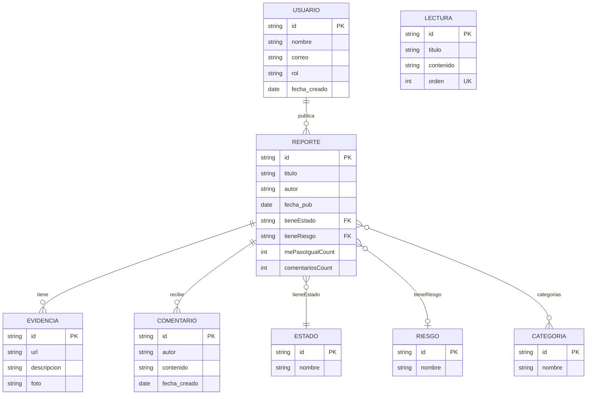
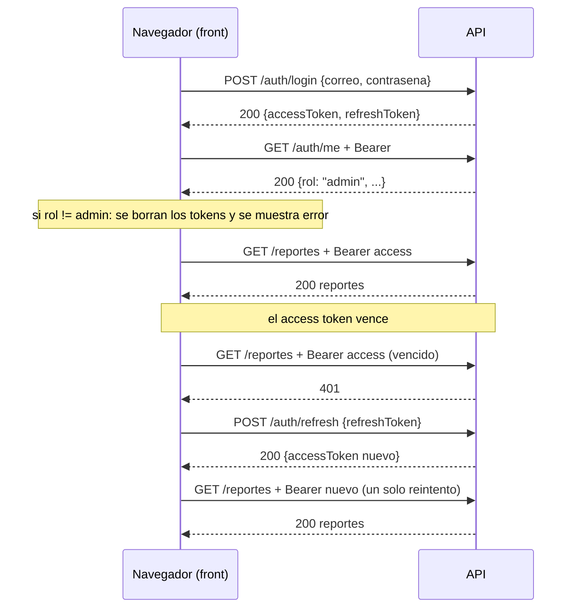

# Documento técnico — Fishy · Panel de moderación (frontend)

> Los diagramas están en **Mermaid**: se ven en la vista previa de VS Code
> (`Cmd/Ctrl + Shift + V`, con la extensión *Markdown Preview Mermaid
> Support*) y en GitHub sin instalar nada.
>
> ¿Para quién es? Para otro desarrollador que recibe el proyecto y tiene que
> correrlo, entenderlo y modificarlo sin preguntarle al equipo. El backend
> **no** está en este repositorio; lo que se documenta del backend es lo que
> el front espera de él.

**Versión:** 1.0 · **Fecha:** 2026-10-21 · **Equipo:** Enrique Cruz Salinas, luisdiaz0369, CamilaQuintanilla11, AlaniGarciaA0

## 1. Resumen

Fishy es una plataforma donde la comunidad reporta fraudes y phishing. Este
repositorio es el **panel web de moderación**: una SPA de React que consume
la API REST de Fishy y solo deja entrar a cuentas con rol `admin`. Permite ver
un resumen con gráficas, revisar la cola de reportes pendientes, aprobarlos
o rechazarlos asignándoles un nivel de riesgo, buscar y filtrar todos los
reportes, administrar usuarios y crear lecturas educativas. Funciona contra
un backend aparte; el front no tiene base de datos ni servidor propio.

## 2. Arquitectura



- **Front** (`frontend/`): SPA de React con React Router. Se construye a
  archivos estáticos (`dist/`); desde el navegador llama directo a la API con
  `fetch` (no usa axios).
- **API** (repositorio aparte): expone los endpoints de la sección 6, emite
  los JWT y guarda en la base de datos. El front asume que responde errores
  como `{ message }`, donde `message` puede ser un arreglo si falla la
  validación.
- **Archivos**: las capturas de evidencia las sirve la API en
  `/uploads/<archivo>`; el front arma la URL como `API + ev.foto`.

## 3. Tecnologías y versiones

| Capa | Tecnología | Versión | Para qué |
|---|---|---|---|
| Lenguaje | JavaScript (JSX) | ES2023+ | todo el front (no usa TypeScript) |
| Runtime | Node.js | 20.19 o superior | requisito de Vite 8 y ESLint 10 |
| Framework | React | 19.2 | interfaz |
| Build / dev server | Vite + `@vitejs/plugin-react` | 8.3 / 6.1 | servidor de desarrollo y build |
| Rutas | react-router-dom | 7.18 | rutas y rutas protegidas |
| Gráficas | Recharts | 3.10 | área, barras y pastel del panel |
| Iconos | lucide-react | 1.53 | iconos de la interfaz |
| Animación | GSAP | 3.15 | **instalada pero sin uso en `src/`** (ver sección 10) |
| Estilos | CSS propio (`index.css`, `App.css`, `*.css` por componente) | — | sin Tailwind ni librería de UI |
| Calidad | ESLint + `react-hooks` + `react-refresh` | 10.10 | `npm run lint` |
| HTTP | `fetch` nativo | — | cliente propio en `src/api/client.js` |

## 4. Instalación y ejecución

### 4.1 Requisitos

- Node.js 20.19 o superior
- El backend de Fishy corriendo y accesible (por defecto `http://localhost:3000`)

### 4.2 Base de datos

No aplica a este repositorio: la base de datos pertenece al backend. Levanta
primero la API y su base según las instrucciones de ese proyecto.

### 4.3 API

Este repositorio no incluye la API. Necesitas tenerla corriendo y con CORS
permitido para el origen del front (`http://localhost:5173` en desarrollo).
Además debe existir al menos un usuario con rol `admin`, porque el panel
rechaza cualquier otra cuenta.

### 4.4 Front

```bash
cd frontend
npm install
cp .env.example .env     # y ajusta VITE_API_URL
npm run dev              # http://localhost:5173
```

Otros comandos:

```bash
npm run build            # genera dist/ (archivos estáticos)
npm run preview          # sirve dist/ para probarlo
npm run lint             # ESLint
```

Variable de entorno (`.env`):

| Variable | Ejemplo | Para qué |
|---|---|---|
| `VITE_API_URL` | `http://localhost:3000` | URL base de la API. Si falta, el código usa `http://localhost:3000` |

Vite solo expone al navegador las variables que empiezan con `VITE_`, y todo
lo que lleve ese prefijo queda visible en el JavaScript final. **Nunca pongas
secretos ahí.** Si te conectas desde otra computadora de la red, cambia
`localhost` por la IP de la máquina donde corre la API.

## 5. Modelo de datos

El front no define esquema; estas son las entidades tal como las consume (los
nombres de campos vienen del código y los debe respetar la API):



- `ESTADO.nombre` toma los valores `pendiente`, `aprobado` y `rechazado`; el
  front compara contra esos textos exactos.
- `RIESGO.nombre` toma `Bajo`, `Medio` y `Alto` (con mayúscula inicial).
  `tieneRiesgo` es `null` mientras el reporte no está clasificado.
- `REPORTE.categorias` llega como arreglo de **nombres** (no de ids).
- `EVIDENCIA.foto` es una ruta relativa tipo `/uploads/archivo.png`; el valor
  `/uploads/` a secas significa "sin foto".
- `LECTURA.orden` debe ser único; lo valida el backend.
- Las relaciones y los tipos son una inferencia hecha leyendo el front. La
  fuente de verdad es el esquema del backend.

## 6. API

Endpoints que usa este front (todos salvo login y refresh envían
`Authorization: Bearer <accessToken>`):

| Método | Ruta | Auth | Qué hace | Se usa en |
|---|---|---|---|---|
| POST | `/auth/login` | no | recibe `{ correo, contrasena }`, regresa `accessToken` y `refreshToken` | `Login` |
| POST | `/auth/refresh` | no | recibe `{ refreshToken }`, regresa tokens nuevos | `client.js` |
| GET | `/auth/me` | Bearer | perfil de quien inició sesión (incluye `rol`) | `Login`, `Layout` |
| GET | `/reportes` | Bearer | lista de reportes | `useReportes` |
| GET | `/estados` | Bearer | catálogo de estados | `useReportes` |
| GET | `/riesgos` | Bearer | catálogo de niveles de riesgo | `useReportes` |
| GET | `/categorias` | Bearer | catálogo de categorías | `useReportes` |
| GET | `/reportes/:id/comentarios` | Bearer | comentarios de un reporte | `DetalleReporte` |
| PATCH | `/reportes/:id/moderar` | Bearer | recibe `{ tieneEstado, tieneRiesgo }` (ids) | `DetalleReporte` |
| GET | `/lecturas` | Bearer | lista de lecturas | `Lecturas` |
| POST | `/lecturas` | Bearer | crea lectura `{ titulo, contenido, orden }` | `Lecturas` |
| GET | `/usuarios` | Bearer | lista de usuarios | `Usuarios` |
| GET | `/usuarios/me` | Bearer | usuario actual (para ocultarlo de la lista) | `Usuarios` |
| DELETE | `/usuarios/:id` | Bearer | elimina un usuario | `Usuarios` |
| GET | `/uploads/<archivo>` | no | imagen de evidencia | `DetalleReporte` |

Errores: el front espera `{ message }`. Si `message` es un arreglo (validación
de DTO) lo une con `". "`; si no hay cuerpo, muestra `Error <status>`. Un
fallo de red se convierte en `ApiError(0, 'No se pudo conectar con el
servidor.')`.

### Pantallas

| Ruta | Página | Qué hace |
|---|---|---|
| `/login` | `Login` | formulario de acceso; rechaza cuentas que no sean `admin` |
| `/` | `Panel` | KPIs, aviso de pendientes, reportes por día (14 días), por categoría y por riesgo, últimos 5 reportes |
| `/por-revisar` | `PorRevisar` | cola de pendientes, ordenada por más "me pasó igual" |
| `/reportes` | `Reportes` | todos los reportes con búsqueda y filtros por estado, riesgo y categoría |
| `/usuarios` | `Usuarios` | búsqueda, paginación (10 por página) y borrado con botón de mantener presionado |
| `/lecturas` | `Lecturas` | tabla de lecturas y modal para crear una nueva |

Cualquier otra ruta redirige a `/`. Todo lo que no sea `/login` pasa por
`RutaProtegida`, que manda a `/login` si no hay `accessToken`.

## 7. Autenticación



- Los tokens son JWT emitidos por el backend; las duraciones y el algoritmo
  de firma se configuran allá (no están en este repositorio).
- El front guarda `accessToken` y `refreshToken` en `localStorage` (llaves con
  esos mismos nombres) desde `src/api/client.js`.
- Antes de guardar, valida que el valor tenga forma de JWT (tres segmentos
  base64url separados por puntos); si no, lanza error y no lo guarda.
- Si varias peticiones reciben 401 al mismo tiempo, comparten **una sola**
  llamada de refresh (variable `refrescando`).
- Cada petición se reintenta **una vez** después del refresh. Si el servidor
  rechaza el refresh, se llama a `cerrarSesion()`: borra los tokens y
  redirige a `/login`.
- El rol `admin` se comprueba en `Login` y otra vez en `Layout` (con
  `/auth/me`); si no es admin se cierra la sesión.
- `Layout` también guarda en `localStorage` la preferencia `sidebar-colapsado`.

## 8. Seguridad

### 8.1 Decisiones tomadas

| Tema | Decisión | Por qué |
|---|---|---|
| Acceso | solo `admin` entra al panel; se verifica en login y en cada carga del layout | un usuario normal no debe ver ni moderar reportes |
| Sesión | access token corto + refresh token, con refresh automático y un solo reintento | el usuario no vuelve a escribir su contraseña cada rato y se evitan bucles de reintento |
| Tokens en storage | solo se guarda un valor que cumpla el formato JWT | evitar que una respuesta anómala meta datos arbitrarios en `localStorage` (Browser Storage Poisoning) |
| Enlaces peligrosos | las URL de evidencia se muestran "desactivadas" (`hxxp://dominio[.]com`) dentro de un `<code>` | el moderador no abre un sitio de phishing por accidente |
| Contenido de usuarios | React escapa el texto; no se usa `dangerouslySetInnerHTML` | evitar XSS con lo que escriben los usuarios |
| Acciones destructivas | borrar usuario exige mantener presionado 2 s (`HoldButton`) y el propio admin no puede borrarse | evitar borrados por un clic accidental |
| Moderación | no se puede decidir sin elegir riesgo; un reporte ya moderado no se puede cambiar desde la UI | decisiones consistentes y trazables |
| Configuración | la URL de la API va en variable `VITE_`; no hay secretos en el front | todo lo que está en el bundle es público |
| Errores | no se escriben errores en consola; se muestran en la interfaz | no filtrar detalles técnicos |

### 8.2 Riesgos conocidos

Lo que **sabemos** que falta o es débil, para que quien reciba el proyecto no
lo descubra a golpes:

| # | Riesgo | Dónde | Impacto | Qué haría falta |
|---|---|---|---|---|
| 1 | Tokens en `localStorage`: cualquier script que corra en la página los lee (XSS) | `src/api/client.js` | robo de sesión de un administrador | cookies `httpOnly` emitidas por la API o endurecer contra XSS (CSP) |
| 2 | `.env` está versionado en el repositorio y `.gitignore` no lo excluye (solo ignora `*.local`); contiene la IP privada `192.168.10.10` | `frontend/.env` | se publica la topología de red y es fácil subir un valor sensible por error | agregar `.env` al `.gitignore`, quitarlo del historial y dejar solo `.env.example` |
| 3 | El rol `admin` se valida en el front, que es controlable por el usuario | `Login.jsx`, `Layout.jsx` | si el backend no lo exige por endpoint, cualquiera con un token podría llamar a `/usuarios` o `/moderar` | confirmar que cada endpoint sensible verifica rol en la API |
| 4 | Cerrar sesión solo borra los tokens locales | `cerrarSesion()` | un token copiado sirve hasta que venza | endpoint de logout con revocación o rotación de refresh |
| 5 | El refresh token viaja en el cuerpo del request y vive en `localStorage` | `client.js` | si se roba, permite sesión de larga duración | cookie `httpOnly` + `SameSite` |
| 6 | Sin límite de intentos visible en el login | `Login.jsx` | fuerza bruta contra cuentas admin | rate limiting en la API (y mensajes genéricos) |
| 7 | No hay pruebas automáticas | todo el proyecto | cambios sin red de seguridad | pruebas de `client.js` (refresh) y de las utilidades |
| 8 | El panel no pagina ni filtra en servidor: baja todos los reportes de golpe | `useReportes.js` | lento con muchos reportes | paginación y filtros en la API |

## 9. Estructura de carpetas

```
Fishy_frontend/
└── frontend/
    ├── index.html
    ├── vite.config.js
    ├── eslint.config.js
    ├── package.json
    ├── .env.example          # plantilla de variables (sí va al repo)
    ├── .env                  # local; ver riesgo 2
    ├── public/               # favicon.svg, icons.svg
    └── src/
        ├── main.jsx          # rutas (React Router) y punto de entrada
        ├── index.css         # estilos globales
        ├── App.css           # estilos del panel (tablas, modal, KPIs, badges)
        ├── api/
        │   ├── client.js     # fetch, tokens, refresh y errores (ApiError)
        │   └── useReportes.js# hook que carga reportes y catálogos
        ├── auth/
        │   └── RutaProtegida.jsx
        ├── pages/            # Login, Panel, PorRevisar, Reportes, Usuarios, Lecturas
        ├── components/
        │   ├── Layout.jsx          # barra lateral + cabecera
        │   ├── TablaReportes.jsx
        │   ├── DetalleReporte.jsx  # modal de detalle y moderación
        │   ├── Badges.jsx          # etiquetas de estado y riesgo
        │   ├── Graficas.jsx        # gráficas de Recharts
        │   ├── HoldButton.jsx/.css # botón de mantener presionado
        │   └── BlobCursor.jsx/.css # efecto visual del login
        ├── utils/
        │   ├── formato.js          # fechas, capitalizar, desactivarUrl
        │   └── estadisticas.js     # agrupados para las gráficas
        └── assets/                 # fishy.png, el_bueno.png, image.png
```

## 10. Pendientes y mejoras

- [ ] Quitar `.env` del repositorio y agregarlo al `.gitignore` (riesgo 2 de la sección 8.2).
- [ ] Reemplazar el `README.md` de `frontend/`: sigue siendo el de la plantilla de Vite.
- [ ] Decidir sobre dependencias y archivos sin uso: `gsap` está instalada pero ningún archivo de `src/` la importa, y las imágenes de `src/assets/` (`fishy.png`, `el_bueno.png`, `image.png`, ~2.4 MB en total) no se referencian desde el código.
- [ ] Mover los tokens a cookies `httpOnly` junto con el equipo del backend (riesgos 1 y 5).
- [ ] Confirmar con el backend la verificación de rol `admin` en cada endpoint (riesgo 3).
- [ ] Documentar duraciones de los tokens y la política de CORS en el repositorio de la API.
- [ ] Pruebas automáticas para `client.js` (flujo de refresh) y `estadisticas.js`.
- [ ] Paginación y filtros del lado del servidor para reportes.
- [ ] Despliegue: definir dónde se publica `dist/` y con qué `VITE_API_URL` se construye.
